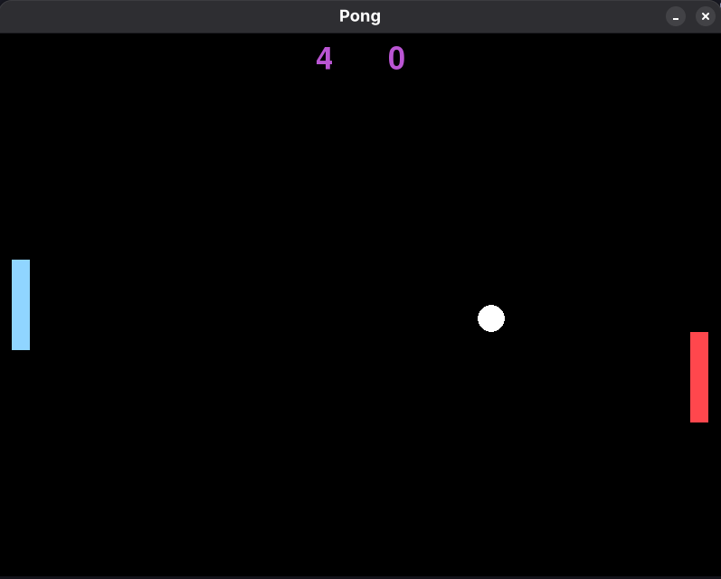
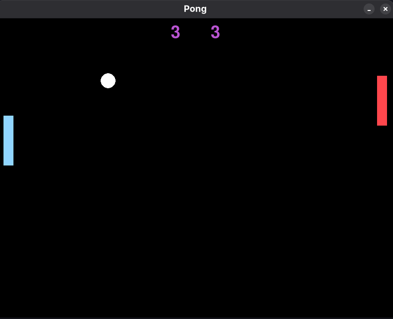

# Pong
A simple pong clone written in [python](https://www.python.org/) using [pygame](https://pypi.org/project/pygame-ce/).

## How to run
1) Create a virutal environment using the follow command on your system `python -m venv venv`.

2) Activate the virtual environment and install the required dependency by using `pip install -r requirements.txt`.

3) Run the `main.py` file in the src directory. The game will start.

## How to play
The *left paddle* is controlle using `W` key for upwards and `S` key for downwards movement. 

The *right paddle* is controlled using `Up Arrow` key for upwards  and `Down Arrow` key for downwards movement.

## Screenshots

